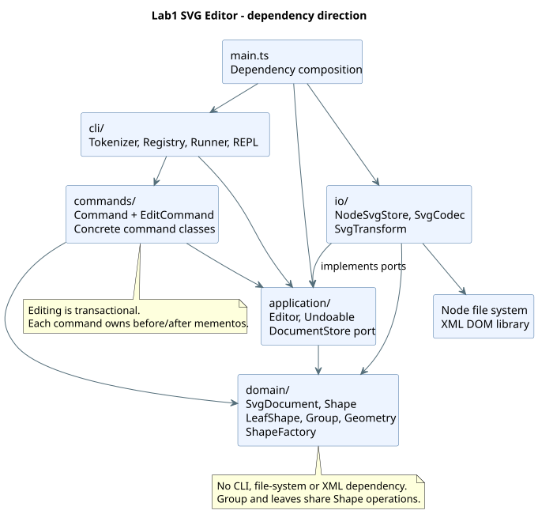

# Lab1 Phase 1：SVG 编辑器

Git 仓库地址：[https://github.com/yugh6/svg-editor](https://github.com/yugh6/svg-editor)


本工程实现 `phase_cli_1.md` 第一阶段：TypeScript 面向对象 CLI、六种图形、树结构编辑、SVG 文件读写与撤销重做。`box` 属后续插件化阶段，第一阶段创建该类型时按要求报错。

## 运行

需要 Node.js 22 或更新版本。请在 Lab1 工程目录执行：

```sh
npm ci
npm run cli
```

```text
svg> init 800 600
svg> create g scene
svg> create rect r1 20 30 120 60 #4a90d9 in scene
svg> create text t1 35 65 "Hello SVG" in scene
svg> move scene 100 20
svg> undo
svg> tree
svg> save demo.svg
```

`help` 显示完整语法。通过 EOF 结束输入：Unix 通常为 Ctrl+D；Windows 可使用 Ctrl+Z 后回车。保存得到的 SVG 可直接在浏览器中打开。

## 检查与构建

```sh
npm run check
npm run build
npm start
```

`check` 包含严格类型检查、71 项自动化测试和生产构建。只运行测试使用 `npm test`。

## 示例回放

PowerShell：

```powershell
$OutputEncoding = [Console]::OutputEncoding = [System.Text.UTF8Encoding]::new()
Get-Content -Encoding utf8 examples/flowchart.cli | npm run cli
```

Bash：

```sh
npm run cli < examples/flowchart.cli
```

- [两节点流程图脚本](../examples/flowchart.cli)、[SVG 输出](../examples/flowchart.svg)、[实际运行记录](../examples/flowchart.transcript.txt)
- [完整会话脚本](../examples/session.cli)、[实际运行记录](../examples/session.transcript.txt)
- [作业指定的外部 SVG](../examples/other.svg)、[补全 ID 后的保存结果](../examples/other-roundtrip.svg)


## 架构方案

### 1. 模块划分与职责

| 模块 | 主要对象 | 职责 |
| --- | --- | --- |
| `src/domain/` | `Shape`、`LeafShape`、`Rect`、`Circle`、`Ellipse`、`Line`、`Text`、`Group`、`Geometry`、`Numeric`、`SvgDocument`、`ShapeFactory` | 封装图形行为、几何验证、容器、ID 唯一性、树操作和领域快照；不接触终端、文件或 XML 库 |
| `src/commands/` | `Command`、`EditCommand`、19 个具体命令类、`Arguments` | 把一条命令封装成对象；验证参数；调用领域操作；编辑命令持有前后快照并实现 undo/redo |
| `src/application/` | `Editor`、`DocumentStore`、`Undoable` | 管理当前文档、文件路径、撤销/重做栈与 IO 屏障；后两者是端口接口 |
| `src/io/` | `NodeSvgStore`、`SvgCodec`、`SvgTransform` | 文件读写、DOM 解析/序列化、自动补 ID、支持的 SVG 变换归一化 |
| `src/cli/` | `Tokenizer`、`CommandRegistry`、`CommandRunner`、`Repl` | 逐行输入、双引号参数解析、名称到命令的分派、统一错误输出和提示符 |
| `src/main.ts` | 装配入口 | 创建具体文件适配器、Editor 和 CLI；仅承担启动与依赖装配 |
| `tests/` | 四组测试、`Harness`、`MemoryStore` | 命令、SVG、真实 IO/进程、架构约束验证 |
| `examples/` | `.cli`、`.svg`、transcript | 作业会话与流程图的可回放脚本、保存结果和真实运行输出 |
| `doc/` | 本文、PlantUML 源文件与 SVG | 设计方案、协作过程、自查与验证证据 |

组件图由 [architecture.puml](architecture.puml) 使用 PlantUML 1.2025.2 的 Smetana 布局渲染，箭头表示源代码依赖方向：



图中的 `io → application` 表示实现应用层定义的接口。运行时 Editor 调用注入的 `DocumentStore`；应用层源代码不导入 `NodeSvgStore`。

### 2. 设计模式的选择及落地

**Command（必选）**

`Command.execute(Editor)` 是统一入口。`CreateCommand`、`MoveCommand`、`GroupCommand` 等具体类分别实现各条语义，不把全部操作塞入一个 `switch`。文档类和显示类也是命令对象，但不进入编辑历史。

`EditCommand` 实现应用层的 `Undoable` 接口。执行时先复制当前 `SvgDocument`，在副本上调用具体类的 `apply`；成功后才保存前后快照、更新当前文档和历史栈。一条 `group` 命令即使移动多个节点也只进入历史一次。失败编辑不发布副本、不压栈、不清空 redo。

**Composite**

`Shape` 定义 `move`、`scale`、`set`、`clone` 等统一操作。五种叶子继承 `LeafShape`，`Group` 保存子节点，并递归实现移动和缩放。命令仅调用 `Shape` 的行为，容器与叶子无需按标签分流。图形有私有 ID、样式及几何状态；`Group.children` 返回数组副本，避免外部直接修改成员数组。

`set g fill ...` 设置组的 SVG 属性，按 SVG 继承规则影响没有显式指定 fill 的后代。后代自身的显式属性优先；这与普通 SVG 分组语义一致。后续 `box` 的属性转发属于插件语义，本阶段没有提前植入。

**Memento**

编辑命令持有执行前后的深复制文档。撤销与重做返回快照的再次复制，历史对象不与当前可编辑对象共用可变状态。这能精确恢复删除的子树、原父节点、z-order 和浮点几何值，不需要依靠反向算术恢复坐标。

代价是每条编辑的快照成本为 O(n)，n 为图形数；保留 h 条历史约需 O(hn) 空间。第一阶段文档规模小，选择这个实现以保证事务性与可读性。未来若实测大文档有压力，再改为命令增量或结构共享。

**工厂与依赖倒置**

`ShapeFactory` 集中创建图形，XML 导入与 `create` 共用该工厂。`Editor` 只依赖 `DocumentStore` 接口，真实运行注入 `NodeSvgStore`，测试注入 `MemoryStore`。终端输入、磁盘和 XML 实现不进入领域层。

**仅有的两处按名称分派，均标注为后续待重构点：**

1. `src/cli/CommandRegistry.ts`：命令名 → 具体命令构造器。
2. `src/domain/ShapeFactory.ts`：图形类型名 → 具体图形构造器。

当前都是固定注册表；未来插件阶段应将注册来源移至装配层并定义注册冲突与生命周期规则。第一阶段保留明确的扩展位置，不实现动态插件装载。

属性白名单判断、参数词法解析和 SVG transform 语法解析属于输入验证；没有在移动、缩放、显示或序列化中按图形标签做行为分派。序列化读取对象提供的属性、文本及子节点。

### 3. 依赖方向规则

| 模块 | 允许依赖 | 原因 |
| --- | --- | --- |
| `domain` | 本模块 | 领域行为不绑定交互方式、存储或 XML 库 |
| `application` | `domain`、本模块接口 | 编排用例与历史；不认识具体命令或文件适配器 |
| `commands` | `application`、`domain`、本模块 | 命令描述操作，通过应用层提交事务 |
| `io` | `application` 接口、`domain`、Node 文件系统、XML 库 | 在边界转换格式并实现存储端口 |
| `cli` | `commands`、`application`、Node readline/stream | 输入适配器负责解析与展示，不直接读写磁盘 |
| `main.ts` | 各装配模块 | 唯一需要知道具体实现组合的启动入口 |
| `tests` | 被测模块与测试依赖 | 允许跨层进行行为验证，不被生产代码依赖 |

例如：`application/Editor.ts` 导入 `SvgDocument`、`DocumentStore`、`Undoable`；`commands/EditCommand.ts` 导入 Editor 的类型和领域文档；`io/NodeSvgStore.ts` 实现 DocumentStore；`domain` 没有任何外部模块导入。违反表中方向的依赖作为待修复项处理，自动架构测试会报错。

### 4. 变化点假设

| 可能变化 | 当前预留 / 暂不预留的理由 |
| --- | --- |
| 新图形与 `box` 插件 | 保留 `Shape` 行为接口、`Group` 组合能力和集中工厂；未来把固定注册改为 ShapeProvider。当前不做内部部件寻址和专用 ungroup 限制，避免把第二阶段需求写进内核 |
| 新增命令 | 增加一类一文件的 Command 子类并注册，不改历史管理和已有图形行为 |
| GUI、鼠标或 agent 交互 | `Editor` 与命令不依赖 REPL；可复用命令对象和领域行为，替换输入适配器 |
| SVG 格式覆盖扩大 | XML 处理集中在 `SvgCodec`；当前支持课程涉及的六类元素、指定样式和常见展示属性。任意路径、CSS、旋转等需要明确几何/样式语义后再扩展 |
| 存储从本地文件变为其他介质 | 已定义 `DocumentStore`；目前接口同步，因为 CLI 没有并发需求，网络存储阶段再改为异步，不提前引入任务框架 |
| 大文档、长历史与查找性能 | 当前快照和 ID 查找使用线性遍历；未来根据测量结果引入索引、增量快照或历史容量，不先引入缓存一致性问题 |
| 输出格式变化 | Shape 提供摘要和属性明细，SvgDocument 负责树形排版；当前没有多个展示主题，暂不额外引入 Visitor 层 |

### 5. 对未完全规定细节的明确决策

- `group` 按原树的深度优先绘制顺序排列成员，与命令参数顺序无关；同父分组放在第一个被选节点的位置。跨父分组放在最近共同祖先中、第一个被选分支的位置，原来未选中的节点保持相互顺序。
- `front` 将节点移至同级列表末尾，符合 SVG 后画在上面的规则；`back` 移至列表开头。作用范围仅为同级。
- `ungroup` 严格拒绝 SVG 的直接子容器；嵌套容器的子节点原位提升。禁止把祖先移进后代，也禁止同次 group 同时选择某容器及其后代。
- `init` 默认为 800×600；只有一个参数时只覆盖宽度。`canvas` 接受零个或两个参数。尺寸必须为有限正数，图形宽高和半径允许为零、不能为负；坐标允许负数和浮点数。
- `scale` 作用于作业参数表定义的全部几何属性，包括坐标与尺寸；stroke-width 和字体大小不属于这些几何字段。容器递归处理后代。导入外部 SVG transform 时另外归一化对应笔画宽度和文字字号。
- `save <path>` 成功后更新默认路径，随后 `save` 可省略路径；新 `init` 清除默认路径。失败 IO 不更改默认路径和历史。
- `init/read/save` 及带参数的 `canvas` 成功后清空历史并设置 IO 屏障；无参数 `canvas`、tree/show/help 不改变历史。下一次成功编辑解除屏障。
- help 在没有当前文档时也可使用。空行和首个非空字符为 `#` 的整行注释跳过；颜色 `#abcdef` 是正常参数，不支持行尾注释。
- 双引号支持空文本、空格、Unicode、`\"` 和 `\\`；其他反斜杠原样保留，避免破坏 Windows 路径。带引号的 `"in"` 作为普通参数，不被当作父容器子句。
- undo/redo 回显 `undone:` / `redone:` 加原操作摘要；以真实恢复后的 tree/show 验证状态。要求中 transcript 的具体撤销措辞视为示例，粒度与结果遵循要求。

### 6. SVG 读写范围

输出是真正的 XML SVG，使用 DOM 创建属性和文本，保证 `<`、`&`、引号等正确转义。缺省 fill/stroke 不写入，保留 SVG 渲染默认行为。文本保存在 text 子文本中。

导入采用两遍 ID 处理：先收集并检查全部显式 ID，再按标签加递增序号为缺失 ID 命名，避开后面尚未解析的同名元素。全部解析成功后才输出警告并替换当前文档；重复 ID、非法几何或不支持的内容不会留下半个文档。

支持嵌套 g、viewBox、px 画布尺寸、字体/对齐等列入导入白名单的展示属性；外部 `translate` 与正的等比 `scale` 会归一化为具体几何。`data-kind="box"` 保留标记但作为普通 g 使用。

本阶段不实现通用 SVG 浏览器：path、tspan、CSS style、脚本、外部实体、旋转、非等比变换等明确报错。禁止静默丢掉不支持的图形。CLI `set` 仍严格使用作业白名单，导入时允许保存的额外展示属性不等于 CLI 新增可设置属性。

`NodeSvgStore` 先在目标目录写入独立临时文件，成功后重命名替换目标；写失败清理自身临时文件。历史屏障在存储成功后才生效。

## 过程记录

以下记录来自本次与 Codex 的实际协作和验证，不代替未发生的人工评审。

| 阶段 | 发现或决定 | 处理及证据 |
| --- | --- | --- |
| 需求阅读 | 初始 Lab1 只有要求文件，尚无实现或 Git 仓库；box 明确在下一阶段 | 创建独立 Lab1 Git 仓库，先提交配置和架构初稿；提交 `764d66d` |
| 领域设计 | 不能把标签判断散落在命令中；组和叶子必须统一操作 | 建立 Shape/LeafShape/Group 多态类层次、Geometry 验证与 SvgDocument 树约束；领域层通过类型检查；提交 `54685da` |
| 原子性决策 | 单次 group 涉及多个原父节点；递归 scale 可能在处理后面的节点时溢出 | 编辑始终在副本上执行，成功后整体发布；后续测试验证树恢复及“前面已算完、后面溢出”的情况 |
| 命令及 IO | 自动补 ID 若只边读边分配，会与文件后方显式 ID 冲突 | 改为先扫描全部显式 ID 再补全；命令使用快照历史，IO 成功才设置屏障 |
| 编译修正 | 安装的 TypeScript 版本没有自动纳入 Node 类型；XML 库将 localName 标注为可空 | 在 tsconfig 显式指定 `types: ["node"]`；类型名使用 `localName ?? tagName`；重新通过类型检查与构建 |
| 首次实际回放 | 验证嵌套创建、移动、撤销、重做、缩放、解组和再撤销 | 编译后直接运行 dist/main.js 回放，输出与树结构正确；提交 `85c06b3` |
| 测试迭代 | 需要验证失败编辑保留 redo、IO 边界及路径，而不能只验证正常输出 | 第一批 40 项命令测试通过；补充 SVG 和真实进程测试达到 69 项；加入依赖与类文件约束达到 71 项；提交 `7d2e1da` |
| 远程交付 | 用户先提供 GitHub 主页，再明确目标仓库为 yugh6/svg-editor；本机 Git 原代理不可达 | 配置指定 origin，仅对本次 Git 调用清空代理选项，直连后成功推送分步开发提交；不修改用户全局代理 |
| 文档收尾 | 初稿没有测试证据、展示图与边界决策 | 补全本文、PlantUML 源与渲染图、真实示例 transcript、快速启动说明；完成后以 final 标记提交 |

主要方案修订：在 `SvgDocument` 补充 viewBox 与根展示属性保存，以防读回后保存丢失画布信息；在 IO 内增加 SvgTransform 处理要求背景示例中的平移与等比缩放。两个变化均落在原计划模块中，未改变依赖方向。

## 一致性自查

### 1. 模块划分是否一致

一致。实际代码目录为 domain、application、commands、io、cli，加 main 装配入口；测试、示例和文档单独存放。每个生产类只有一个同名文件，端口接口文件也按接口命名。没有把领域行为退化为公共数据袋或自由函数集合。

新增的 `Geometry`、`Arguments`、`SvgTransform` 是既有模块内的职责细分；viewBox 支持的方案修订已在上节记录。没有未记录的顶层模块偏离。

### 2. 依赖方向是否被违反

未发现违反。`tests/architecture.test.ts` 自动扫描所有生产模块导入，按上表检查；同时验证一类一文件和不存在按 tag/type 的 switch 分派。两个架构测试均通过。

抽样结果：

- Shape/Geometry/Group 仅引用 domain 内的类型和行为。
- Editor 通过 DocumentStore/Undoable 接口工作，不导入 io 或 commands 的具体实现。
- EditCommand 依赖应用层接口和领域文档，不访问 Node 文件系统。
- NodeSvgStore 承担文件 IO；SvgCodec 使用 XML 库；CLI 不直接处理 SVG 文本。
- main 是装配具体对象的唯一入口，依赖范围符合预先约定的例外。

源码中的两个固定名称注册表依然是**下一阶段的待重构点**，不声称已经实现运行时插件化。

## 质量保证手段

### 1. 自动验证

在 Lab1 目录运行：

```sh
npm ci
npm run check
```

2026-10-25 本机实测：Node.js v24.21.0，`npm run check` 的严格类型检查、71 项测试、生产构建全部通过，0 失败、0 跳过。

| 测试文件 | 数量 | 主要保证 |
| --- | ---: | --- |
| `tests/editor.test.ts` | 40 | 全命令、五种叶子及 g、白名单、浮点数、空文本/转义、树结构、顺序、环拒绝、undo/redo、IO 屏障和失败原子性 |
| `tests/svg.test.ts` | 24 | 六类 SVG 往返、文本转义、ID 补全与碰撞、命名空间、畸形 XML、错误文件不替换文档、viewBox、变换归一化 |
| `tests/integration.test.ts` | 5 | 真实文件保存与替换、失败路径、无临时文件残留、CLI 子进程/EOF/CRLF/Unicode、两段作业会话回放 |
| `tests/architecture.test.ts` | 2 | 模块依赖方向、一类一文件及无 tag/type switch |

核心回归点不是简单重复实现：每个命令失败后比较完整树，撤销后比较操作前树；对递归运算溢出验证所有前序节点保持原状；对失败 IO 验证历史及默认文件路径保持可用；对 SVG 使用编码→解析→再编码验证往返稳定性。

### 2. 需求覆盖映射

| 要求 | 实现与验证位置 |
| --- | --- |
| TypeScript/OOP、一类一文件 | `src/domain` 类层次；严格编译；architecture 测试 |
| Command、Composite | Command/EditCommand、Shape/Group；editor 中嵌套操作和整条撤销 |
| init/read/save/canvas | 对应四个命令类、Editor、NodeSvgStore；IO 边界测试 |
| create/delete/move/scale/set | 对应命令类、工厂、Shape 多态；所有类型参数及白名单测试 |
| group/ungroup/addto | SvgDocument 的结构约束；父子关系、跨父分组、原位提升和环检测测试 |
| front/back | 同级重排；SVG 后画优先的顺序断言 |
| tree/show/help | 领域摘要与命令注册信息；几何内联与父节点输出断言 |
| undo/redo、失败不改状态 | 副本事务与命令快照；原树比较、redo 分支与 IO 屏障测试 |
| SVG 缺 ID 自动补全并警告 | SvgCodec 双遍分配；全文件碰撞及只在成功后输出警告测试 |
| 提示符、注释、双引号、error 前缀 | Tokenizer/Runner/Repl；命令测试及真实子进程测试 |
| Git 分步提交及最终 tag | 仓库保留 scaffold → domain → commands/IO → tests → docs 的真实提交历史；最终标签 `final` |
| Markdown 文档及架构图 | 本文件、architecture.puml、architecture.svg |

### 3. 可复核的实际产物

- [flowchart.cli](../examples/flowchart.cli) → [flowchart.svg](../examples/flowchart.svg) → [实际运行记录](../examples/flowchart.transcript.txt)：八个元素，移动容器后撤销，修改文字并保存。
- [session.cli](../examples/session.cli) → [实际运行记录](../examples/session.transcript.txt)：包含要求中的分组错误、保存后禁撤销和外部 SVG 导入警告。
- [other.svg](../examples/other.svg) → [other-roundtrip.svg](../examples/other-roundtrip.svg)：无 ID 的矩形被命名为 rect1，七个元素完整保存。

可用 `git log --oneline --reverse` 检查开发过程，用 `git show final` 定位最终版本。作业文档没有给出具体截止日期，因此不对“早于截止时间”作无法验证的声明；标签本身记录实际完成时间。
